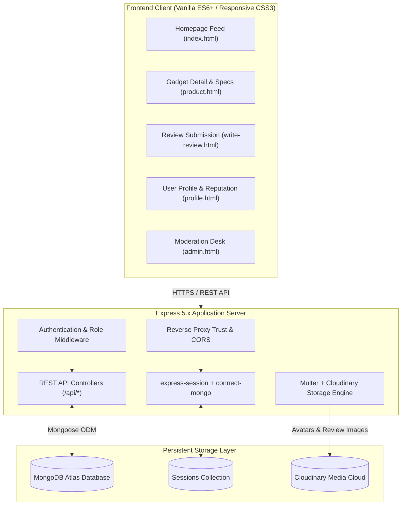

# HonneReviews ⚡

[](https://nodejs.org/)
[](https://expressjs.com/)
[](https://www.mongodb.com/atlas)
[](https://cloudinary.com/)
[](https://www.back4app.com/)
[](https://opensource.org/licenses/ISC)

> **Crowdsourced Gadget & Tech Review Platform**  
> *A full-stack, community-driven tech review hub providing authentic consumer hardware benchmarks and feedback with zero sponsored bias.*

---

## 📖 Table of Contents

- [Overview & Philosophy](#-overview--philosophy)
- [System Architecture](#-system-architecture)
- [Core Features](#-core-features)
- [Tech Stack](#-tech-stack)
- [Project Structure](#-project-structure)
- [Environment Configuration](#-environment-configuration)
- [Local Setup & Development Guide](#-local-setup--development-guide)
- [Default Seed Credentials](#-default-seed-credentials)
- [REST API Reference](#-rest-api-reference)
- [Deployment & Container Resilience](#-deployment--container-resilience)
- [License](#-license)

---

## 🔭 Overview & Philosophy

In an era saturated with paid influencer content, affiliate link farms, and sponsored product placement, finding candid, long-term tech impressions has become increasingly difficult.

**HonneReviews** (inspired by the Japanese concept of *Honne* / 本音 — genuine, unfiltered feelings vs. public façade) was engineered to re-democratize consumer electronics evaluations:

1. **Unfiltered Community Voices**: Buyers share uncensored hands-on impressions, durability reports, and real-world battery/performance metrics.
2. **Zero Orphaned Products**: The catalog is dynamically community-driven; gadgets only exist in the catalog if verified buyer reviews exist.
3. **Consensus-Driven Moderation**: No single moderator holds unilateral ban power over genuine opinions. Spam or abusive submissions require multi-admin consensus before automated removal.
4. **Cloud-First Persistence**: Fully stateless container operation with off-loaded asset pipelines ensuring zero data loss across container teardowns and rebuilds.

---

## 🏛️ System Architecture



---

## ✨ Core Features

### 1. Community Reviews & Multi-Metric Ratings
- **Dynamic Rating Breakdown**: Calculates real-time 1-to-5 star breakdowns, average score aggregates, and review counts.
- **Top-Rated Snippet Cards**: Main product cards dynamically render the headline and excerpt of the highest net-score review submitted by the community.
- **Likes & Dislikes System**: Community members vote on whether reviews were helpful (`likes`) or unhelpful (`dislikes`), shaping the credibility score of submissions.
- **Multi-Photo Attachments**: Users upload up to 8 real-world photo proofs with client-side previews and direct cloud persistence.

### 2. Self-Pruning Product Catalog
- **Active Review Requirement**: Product records only display on the homepage feed if they possess at least one active, non-removed review (`numReviews > 0`).
- **Automated Orphan Cleanup**: When reviews are deleted by users or pruned by administrators, the backend checks remaining active reviews for the associated product. If zero reviews remain:
  - The orphaned `Product` document is automatically deleted from MongoDB.
  - Associated product thumbnail assets are safely removed from Cloudinary.

### 3. Multi-Admin Consensus Moderation Protocol
- **Role Hierarchy**: Structured into standard buyers (`user`), moderators (`admin`), and system administrators (`master_admin`).
- **Multi-Admin Consensus**: A single moderator flag marks a review as pending review (`flaggedBy: [adminId]`). A review is only automatically removed from public feeds when **at least 3 distinct administrators** flag the item.
- **Dedicated Moderation Desk**: Admins access `/admin.html` with real-time statistics (total products, active reviews, pending flags, auto-removed spam), review dismissal, and instant audit actions.
- **Sub-Admin Provisioning**: Master administrators can provision new moderator credentials directly through the admin interface.

### 4. Persistent Cloud Media Pipeline
- **Smart Face-Cropped Avatars**: Profile picture uploads are piped through `multer-storage-cloudinary` into the `honne_avatars` directory, transformed with `{ width: 250, height: 250, crop: 'fill', gravity: 'face' }`.
- **Review Photos Pipeline**: Review images persist under `honne_reviews` with `{ width: 1200, crop: 'limit' }` optimizations.
- **Container Safe**: Container redeployments on platforms like Back4App, Railway, or Render will never wipe user avatars or review images.

### 5. Mobile-First, Defensive UI Architecture
- **Responsive Flex & Grid**: Navbars, category filters, product cards, and admin tables automatically adapt from 4K displays down to 320px mobile screens.
- **Defensive Layout Constraints**: `overflow-x: hidden`, stable scrollbar gutters, universal `border-box` sizing, and dynamic navbar collapsing eliminate horizontal screen jitter.

---

## 🛠️ Tech Stack

### Backend
- **Node.js** (LTS v18+ / v20+)
- **Express.js 5.x** — Core REST application framework
- **express-session & connect-mongo** — Distributed session persistence in MongoDB
- **Mongoose 9.x** — MongoDB ODM with counter fields, hooks, and relational population
- **bcryptjs** — Password hashing with cryptographic salts
- **Multer & multer-storage-cloudinary** — Multi-part stream upload middleware
- **Cloudinary SDK** — Remote image storage, face detection, and transformation

### Frontend
- **Semantic HTML5** — Accessible, clean markup
- **Vanilla Modern JavaScript (ES6+)** — Zero bloated frontend frameworks; lightweight DOM manipulation, fetch API, and modular event listeners
- **Responsive CSS3** — CSS Variables, Flexbox, CSS Grid, media queries, and Chromium sub-pixel rendering fixes (`will-change: transform; backface-visibility: hidden;`)

---

## 📁 Project Structure

```text
web_review_hub/
├── config/
│   └── db.js                   # Mongoose connection & reconnection lifecycle
├── middleware/
│   └── auth.js                 # Session authentication & role verification (isAdmin, isMasterAdmin)
├── models/
│   ├── Product.js              # Product schema with specifications & review counters
│   ├── Review.js               # Review schema with ratings, images, likes, and multi-admin flags
│   └── User.js                 # User schema with bcrypt password hashing & role definitions
├── public/
│   ├── css/
│   │   └── style.css           # Global stylesheet, design system variables, and responsive media queries
│   ├── images/
│   │   ├── default-avatar.svg  # High-resolution SVG fallback avatar
│   │   ├── default-gadget.svg  # Fallback hardware product placeholder
│   │   └── logo.png            # Official HonneReviews brand logo (2151×489)
│   ├── js/
│   │   ├── admin.js            # Admin moderation desk logic & sub-admin provisioning
│   │   ├── app.js              # Homepage catalog loader, search filtering, and card rendering
│   │   ├── auth-nav.js         # Unified responsive navbar auth capsule & dropdown
│   │   ├── auth.js             # User login, registration, and admin authentication
│   │   ├── product.js          # Product detail view, specifications editor, and review submissions
│   │   ├── profile.js          # User profile view, avatar uploader, and review management
│   │   ├── user.js             # Public member profile view & community reputation
│   │   └── write-review.js     # Standalone review creation workflow with multi-file dropzone
│   ├── admin.html              # Administrator moderation console
│   ├── admin-login.html        # Secure staff login portal
│   ├── index.html              # Main public landing & catalog feed
│   ├── login.html              # Member login view
│   ├── product.html            # Product benchmark detail page
│   ├── profile.html            # Member profile & authored review management
│   ├── register.html           # Community registration view
│   ├── user.html               # Public user portfolio view
│   └── write-review.html       # Review composition page
├── routes/
│   ├── adminRoutes.js          # Moderation desk, stats, flag dismissal, and sub-admin creation
│   ├── authRoutes.js           # Member register, login, admin-login, logout, and session check
│   ├── productRoutes.js        # Catalog search, category filter, specs editor, and orphan pruning
│   ├── reviewRoutes.js         # Review composition, edit, deletion, likes/dislikes, and flagging
│   └── userRoutes.js           # Profile update, Cloudinary avatar upload, and user review aggregation
├── scripts/
│   └── seed.js                 # Database seeding fixture with mock products, users, and reviews
├── utils/
│   └── cleanImage.js           # Safe asset removal utility for Cloudinary and local uploads
├── .env.example                # Sample environment variable template
├── .gitignore                  # Git tracking exclusion list
├── package.json                # Project dependencies & scripts
└── server.js                   # Application entry point, Express setup, proxy trust & static routing
```

---

## ⚙️ Environment Configuration

Create a `.env` file in the project root by copying the template:

```bash
cp .env.example .env
```

| Variable | Required | Type | Description | Example / Default |
| :--- | :---: | :---: | :--- | :--- |
| `PORT` | Optional | Number | HTTP listener port | `5000` |
| `NODE_ENV` | Optional | String | Environment mode (`development` or `production`) | `development` |
| `MONGO_URI` | **Required** | String | MongoDB connection URI (local or MongoDB Atlas) | `mongodb://127.0.0.1:27017/web_review_hub` |
| `SESSION_SECRET` | **Required** | String | Secret key used to sign the session ID cookie | `honne_secret_key_change_in_production` |
| `CLOUDINARY_CLOUD_NAME` | **Required** | String | Cloudinary cloud account name | `your_cloudinary_cloud_name` |
| `CLOUDINARY_API_KEY` | **Required** | String | Cloudinary API Key | `your_cloudinary_api_key` |
| `CLOUDINARY_API_SECRET` | **Required** | String | Cloudinary API Secret | `your_cloudinary_api_secret` |

---

## 🚀 Local Setup & Development Guide

### Prerequisites
- **Node.js** v18.0.0 or higher
- **npm** v9.0.0 or higher
- **MongoDB** running locally or a free [MongoDB Atlas](https://www.mongodb.com/atlas) cluster
- A free [Cloudinary](https://cloudinary.com/) account for image uploads

### Installation Steps

1. **Clone the Repository**:
   ```bash
   git clone https://github.com/DaylightO7/honne-reviews.git
   cd honne-reviews
   ```

2. **Install Dependencies**:
   ```bash
   npm install
   ```

3. **Configure Environment Variables**:
   ```bash
   cp .env.example .env
   # Open .env in your editor and enter your MongoDB Atlas URI and Cloudinary credentials
   ```

4. **Seed Database Fixtures**:
   Populate initial test products across categories, sample reviews, moderators, and test buyers:
   ```bash
   npm run seed
   ```

5. **Start the Development Server**:
   ```bash
   npm start
   # Or with auto-reload:
   npm run dev
   ```

6. **Access the Application**:
   - Open your browser to [http://localhost:5000](http://localhost:5000)
   - Admin Moderation Desk: [http://localhost:5000/admin.html](http://localhost:5000/admin.html)

---

## 🔑 Default Seed Credentials

After running `npm run seed`, the following accounts are pre-configured for testing:

| Role | Email | Password | Permissions |
| :--- | :--- | :--- | :--- |
| **Master Admin** | `masteradmin@gmail.com` | `masteradmin123` | Full access: review moderation, flag dismissals, specs editing, sub-admin provisioning |
| **Moderator (Admin)** | `admin1@honnereviews.com` | `adminpassword123` | Review moderation, consensus flagging, review deletions, specs editing |
| **Buyer (User)** | `sarah@buyer.com` | `password123` | Review submissions, photo uploads, avatar management, likes/dislikes |
| **Buyer (User)** | `alex@buyer.com` | `password123` | Standard community participant |
| **Buyer (User)** | `david@buyer.com` | `password123` | Standard community participant |

---

## 📡 REST API Reference

### 🔐 Authentication (`/api/auth`)

| Method | Endpoint | Access | Description |
| :--- | :--- | :--- | :--- |
| `POST` | `/api/auth/register` | Public | Register new community user and initiate session |
| `POST` | `/api/auth/login` | Public | Authenticate user credentials and create session |
| `POST` | `/api/auth/admin-login` | Public | Authenticate staff credentials (`admin` / `master_admin`) |
| `GET` | `/api/auth/me` | Authenticated | Fetch session user synchronized with database |
| `POST` | `/api/auth/logout` | Authenticated | Destroy active session and clear session cookie |

### 📦 Products (`/api/products`)

| Method | Endpoint | Access | Description |
| :--- | :--- | :--- | :--- |
| `GET` | `/api/products` | Public | Get all products with at least 1 verified review (supports `category` and `search` query parameters) |
| `GET` | `/api/products/:id` | Public | Get product details, specs, dynamic banner, and active reviews |
| `POST` | `/api/products` | Authenticated | Create a new product entry |
| `PUT` | `/api/products/:id/specs` | Admin | Update key-value technical specifications |
| `DELETE` | `/api/products/:id` | Admin / Creator | Delete product, associated reviews, and Cloudinary media |

### ⭐ Reviews (`/api/reviews`)

| Method | Endpoint | Access | Description |
| :--- | :--- | :--- | :--- |
| `POST` | `/api/reviews` | Authenticated | Submit review with star rating, text, and up to 8 images |
| `GET` | `/api/reviews/product/:productId`| Public | Fetch all approved reviews for a specific gadget |
| `GET` | `/api/reviews/my-reviews` | Authenticated | Fetch all reviews submitted by the authenticated user |
| `PUT` | `/api/reviews/:id` | Authenticated | Edit review text, heading, rating, or photos |
| `DELETE` | `/api/reviews/:id` | Authenticated | Delete authored review (triggers automatic orphan product removal if 0 reviews remain) |
| `POST` | `/api/reviews/:id/like` | Authenticated | Like a review (toggles vote) |
| `POST` | `/api/reviews/:id/dislike` | Authenticated | Dislike a review (toggles vote) |
| `POST` | `/api/reviews/:id/flag` | Admin | Moderator flag (auto-removes review upon 3 admin consensus) |

### 👤 User Profile (`/api/users`)

| Method | Endpoint | Access | Description |
| :--- | :--- | :--- | :--- |
| `GET` | `/api/users/profile` | Authenticated | Get current user's profile, bio, and aggregated reputation stats |
| `PUT` | `/api/users/profile` | Authenticated | Update user bio description |
| `POST` | `/api/users/avatar` | Authenticated | Upload profile avatar (persisted via Cloudinary face-crop) |
| `GET` | `/api/users/:id` | Public | View public member profile, bio, and authored review history |

### 🛡️ Admin Moderation (`/api/admin`)

| Method | Endpoint | Access | Description |
| :--- | :--- | :--- | :--- |
| `GET` | `/api/admin/stats` | Admin | System dashboard counters (users, products, reviews, flags) |
| `GET` | `/api/admin/reviews/flagged` | Admin | Fetch all reviews pending moderation or auto-removed |
| `GET` | `/api/admin/reviews/all` | Admin | Fetch all reviews across the platform |
| `POST` | `/api/admin/reviews/:id/dismiss` | Admin | Dismiss flags and restore review to public feed |
| `POST` | `/api/admin/reviews/:id/flag` | Admin | Add admin consensus flag |
| `DELETE` | `/api/admin/reviews/:id` | Admin | Permanently delete review and purge cloud images |
| `POST` | `/api/admin/create-admin` | Master Admin | Provision new sub-admin moderator credentials |

---

## 🚢 Deployment & Container Resilience

When deploying HonneReviews to container platforms (such as **Back4App Containers**, **Render**, **Railway**, or **Docker on AWS/GCP**), keep the following architectural decisions in mind:

### 1. Reverse Proxy Trust & HTTPS Cookies
- The application executes `app.set('trust proxy', true)` immediately after instantiating Express.
- This ensures Express correctly evaluates `X-Forwarded-Proto` and `X-Forwarded-For` headers from SSL-terminating reverse proxies (e.g. CloudFront, Cloudflare, NGINX).
- Session cookies are configured with `sameSite: 'lax'` and `httpOnly: true` to prevent cross-site request dropping while retaining persistent authentication state across redirects.

### 2. Distributed Sessions via MongoDB
- Sessions are stored directly in MongoDB via `connect-mongo` rather than in-memory memory stores (`MemoryStore`).
- Server restarts, container rebuilds, and multi-instance scaling maintain user sessions for up to 14 days without requiring users to log back in.

### 3. Cloudinary Ephemeral Disk Defense
- Container filesystems are ephemeral; files written to local disk are wiped on container restart or redeploy.
- All user avatar uploads (`honne_avatars`) and review photo attachments (`honne_reviews`) stream directly to Cloudinary.
- Automated cleanup utilities (`cleanCloudinaryImage`) ensure that when an orphaned product or review is deleted, assets are also unlinked from Cloudinary via public ID to avoid orphaned cloud storage costs.

---

## 📄 License

This project is licensed under the [ISC License](https://opensource.org/licenses/ISC). Free to use, adapt, and distribute for personal and educational purposes.
